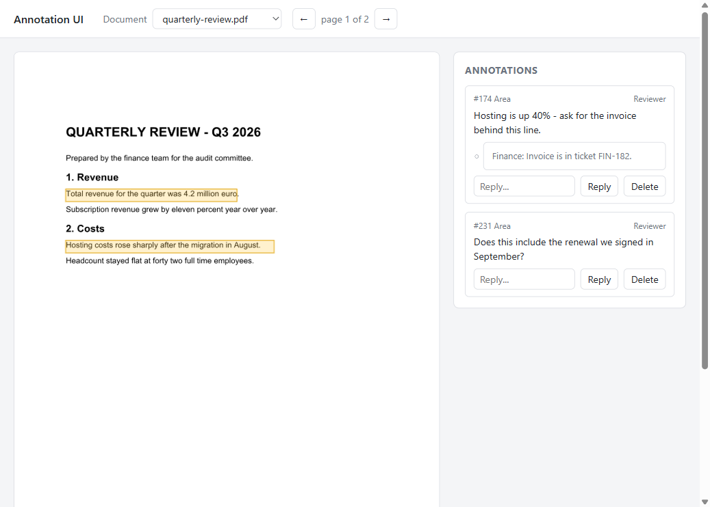

# A browser annotation UI on a UI-agnostic API

[](https://github.com/groupdocs-annotation/browser-annotation-ui-net/actions/workflows/build.yml)
[](https://www.nuget.org/packages/GroupDocs.Annotation/)
[](https://dotnet.microsoft.com/)
[](LICENSE)

GroupDocs.Annotation has no user interface — it reads and writes markup inside documents. This
sample is the missing half: **an ASP.NET Core minimal API and about 250 lines of plain JavaScript**
that let someone drag a box on a page, type a comment, and have it land in the PDF or Word file on
the server.

No Angular, no React, no build step, no CDN. Everything is served from `wwwroot`, so it also runs
on a machine with no outbound network access.



## Read this with

| Resource | What it adds |
|---|---|
| [Blog: Build a browser annotation UI on GroupDocs.Annotation](https://blog.groupdocs.com/annotation/build-browser-annotation-ui-aspnet-core/) | why four endpoints are enough, and what the canvas has to do |
| [Docs: Build an annotation UI for your web app](https://docs.groupdocs.com/annotation/net/build-annotation-ui-for-web-app/) | the reference walk-through of the same design |
| [This repository](https://github.com/groupdocs-annotation/browser-annotation-ui-net) | the code that runs |

## Quick start

Requires the [.NET SDK 8.0 or later](https://dotnet.microsoft.com/download).

```bash
git clone https://github.com/groupdocs-annotation/browser-annotation-ui-net.git
cd browser-annotation-ui-net
dotnet run --project src/AnnotationUi
```

Open the URL it prints. The two files in `samples/` are copied into `storage/` on first start, so
the originals stay clean. Drag on the page, type a comment, and reload the browser — the markup is
in the file, not in the page.

Prove it with any other tool:

```bash
dotnet run --project ../annotate-pdf-csharp-net/src/AnnotatePdf -- list storage/quarterly-review.pdf
```

### Docker

```bash
docker build -t annotation-ui .
docker run --rm -p 8080:8080 annotation-ui
```

The image installs `fontconfig` and `fonts-liberation`; the .NET runtime image has no fonts and
page rendering needs them. Add `--network none` to watch it work with no egress at all.

## The API

| Method | Route | Purpose |
|---|---|---|
| `GET` | `/api/documents` | names in the storage folder |
| `GET` | `/api/documents/{name}/info` | page count and the size of every page, in points |
| `GET` | `/api/documents/{name}/pages/{n}/image` | PNG of page `n` (1-based), rendered without annotations |
| `GET` | `/api/documents/{name}/annotations` | every annotation as one top-left rectangle in page units |
| `POST` | `/api/documents/{name}/annotations` | add one; the body carries pixels plus the image size they were drawn on |
| `PUT` | `/api/documents/{name}/annotations/{id}` | change the message or append a reply |
| `DELETE` | `/api/documents/{name}/annotations/{id}` | remove one |

Each write returns the full annotation list, so the browser never has to guess what the server now
holds.

## How it works

**Pages are images, markup is data.** The server renders each page once with
`RenderAnnotations = false` and caches the PNG; the canvas draws the rectangles on top. A new
comment therefore costs one small write and no re-render, and the markup stays selectable,
clickable and answerable instead of being baked into a picture.

```csharp
PreviewOptions previewOptions = new(page => File.Create(...))
{
    PreviewFormat = PreviewFormats.PNG,
    PageNumbers = new[] { pageNumber },   // 1-based
    RenderAnnotations = false,
    Resolution = 144
};
annotator.Document.GeneratePreview(previewOptions);
```

**Pixels become page units on the server.** The browser sends the rectangle it drew together with
the size of the image it drew on, so nothing breaks when the preview resolution changes or the
image is scaled by CSS:

```csharp
double scaleX = page.Width / request.ImageWidth;
double scaleY = page.Height / request.ImageHeight;

annotator.Add(new AreaAnnotation
{
    PageNumber = page.PageNumber - 1,     // PageInfo is 1-based, annotations are 0-based
    Box = new Rectangle(
        (float)(request.X * scaleX), (float)(request.Y * scaleY),
        (float)(request.Width * scaleX), (float)(request.Height * scaleY)),
    ...
});
```

**One origin leaves the server.** `AreaAnnotation.Box` is measured from the top-left of the page,
but text markup (`HighlightAnnotation.Points` and friends) is measured from the **bottom-left**.
`DocumentService.ToDto` converts the second kind so the front end only ever sees top-left boxes —
which is why a highlight made by Word or by the
[AI review sample](https://github.com/groupdocs-annotation/ai-document-review-annotations-net)
shows up in the right place in this UI.

**Writes swap files.** `Annotator` keeps the source open and cannot save over the file it is
reading, so every change is written next to the original and moved into place afterwards, under a
per-document lock. The preview cache for that document is dropped at the same time.

## Known limits — read before copying this into production

* **Annotation ids are assigned when the document is read, not stored in it.** They change after a
  write. This UI reloads the list after every change, which is enough for one reviewer; for several
  at once, keep the annotations in your own table and the document as the rendering target. The
  import and export API is the bridge.
* **There is no authentication and no authorisation.** Every caller is "Reviewer".
* **Storage is a folder.** `Resolve()` strips the path so a request cannot escape it, but there is
  no quota, no versioning and no audit trail.
* **The whole document is rewritten on every change.** That is fine for a 30-page contract and
  wrong for a 2,000-page archive.

## Layout

```
src/AnnotationUi/
  Program.cs            the endpoints
  DocumentService.cs    every GroupDocs.Annotation call, plus locking and the preview cache
  Models.cs             the DTOs the browser sees
  wwwroot/
    index.html
    app.js              canvas, drag-to-draw, the annotation panel
    styles.css          light and dark
samples/                copied into storage/ on first start
```

## Licensing

Without a licence the library runs in evaluation mode and the page images carry evaluation marks.
Set `GROUPDOCS_ANNOTATION_LICENSE` to the path of a `.lic` file to remove them —
[temporary licence](https://purchase.groupdocs.com/temporary-license).

## Related samples

* [annotate-pdf-csharp-net](https://github.com/groupdocs-annotation/annotate-pdf-csharp-net) — the
  same calls from the command line
* [ai-document-review-annotations-net](https://github.com/groupdocs-annotation/ai-document-review-annotations-net) —
  a model writing the first pass of the review
* [GroupDocs.Annotation-for-.NET](https://github.com/groupdocs-annotation/GroupDocs.Annotation-for-.NET) —
  the full example set

## License

MIT, see [LICENSE](LICENSE). GroupDocs.Annotation itself is a commercial library with its own
[licence terms](https://purchase.groupdocs.com/policies/).
